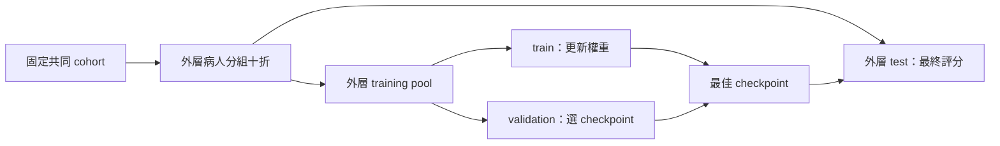

# Public source snapshot

Legacy files, datasets, private results and local environments are not included in this repository.

# 單流與多流 OCT 實驗

一套清楚的流程，完成資料檢查、訓練、模型選擇、交叉驗證、外部驗證與推論。單流及 2–8 流共用程式，只需更改設定中的 `data.streams`。

**原始版本完整保留在 `../old/`。** 這是整理後的新實驗框架，並修正舊版的評估設計；不是逐字搬移舊版，也不會產生相同定義的舊分數。

## 1. 整理方式

```text
multistream_project/
├── old/                         # 原有程式、模型、圖片、records、wandb、稽核
├── new/
│   ├── main.py                  # 訓練／驗證與本機 checkpoint 推論入口
│   ├── configs/                 # 共用設定與單流／多流範例
│   ├── multistream/
│   │   ├── config.py            # 設定繼承、路徑與參數檢查
│   │   ├── data.py              # 資料掃描、manifest、同步影像前處理
│   │   ├── splits.py            # 固定病人分組，外層 test／內層 validation
│   │   ├── models.py            # 通用單流／特徵融合模型及 strict checkpoint
│   │   ├── metrics.py           # Accuracy、F1、各類 recall、AUROC、混淆矩陣
│   │   ├── engine.py            # 訓練、選模、測試、逐例預測輸出
│   │   ├── gradcam.py           # ResNet 的各 stream Grad-CAM
│   │   └── cli.py               # 將上列模組連成命令流程
│   ├── tools/
│   │   ├── create_demo_data.py  # 產生合成圖片，確認程式流程
│   │   ├── run_experiments.py   # 在相同 split 上比較 16 組條件
│   │   ├── infer_published.py   # 選擇 Hugging Face condition／fold 推論
│   │   ├── export_model_collection.py # 匯出全部 stream／fold 模型
│   │   └── upload_model_collection.py # 核對並逐模型上傳／續傳
│   ├── tests/                   # 資料隔離、載入、指標及完整流程測試
│   ├── artifacts/              # prepare 後產生 manifest.json / splits.json
│   └── runs/                   # 每組實驗獨立目錄，不覆蓋舊紀錄
├── archive_manifest.json
└── README.md
```

### 舊版與新版的差異

| 項目 | 舊版 | 新版 |
|---|---|---|
| 程式入口 | 依 stream 數量複製多個 train 檔案 | 一個入口與通用模型 |
| 切分單位 | 病例資料夾隨機切折 | 以 `patient_id` 分組 |
| 驗證與測試 | 同一 fold 選最佳模型並報告峰值 | 內層 validation 選模；外層 test 最後評分 |
| 資料切分保存 | 同一 JSON 可能被覆寫 | 固定 manifest / splits，使用指紋核對 |
| 前處理 | 訓練驗證與推論的 crop 參數不同 | checkpoint 保存設定，驗證／推論使用相同設定 |
| 輸入順序 | 依 dict 與外部模板排列 | checkpoint 明確保存 streams 的順序 |
| 模型載入 | 推論 `strict=False` | strict，缺參數或額外參數都拒絕 |
| 結果 | Accuracy / loss，推論只保存 hard label | 保存每類機率、各類指標與逐例 CSV |

## 2. 環境

建議 **Python 3.11**，程式需要 Python 3.10 以上及 PyTorch 2.6 以上。此次整理在 `new/.venv/` 建立了獨立 CPU 測試環境；不用原本的舊 PyTorch 環境。

在 Windows 的 `new/` 目錄可直接使用：

```powershell
.\.venv\Scripts\python.exe main.py --help
.\.venv\Scripts\python.exe -m pytest tests -q
```

若搬到其他電腦，重新建立環境，不要複製 `.venv/`：

```bash
# 確認此處 python 是 Python 3.11，再建立環境
python -m venv .venv
# Windows: .venv\Scripts\activate
# Linux/macOS: source .venv/bin/activate
python -m pip install -r requirements-dev.txt
```

正式 GPU 訓練時，先依 [PyTorch 官方安裝頁](https://pytorch.org/get-started/locally/) 安裝符合 CUDA 的 torch／torchvision，再安裝 requirements。CPU 測試環境本身不支援 CUDA；`device: auto` 會依目前環境選擇 CPU 或 GPU。

第一次使用 `model.pretrained: true` 會下載 ImageNet 權重；離線測試使用 `pretrained: false`。

## 3. 先跑一個合成資料範例

以下是在 `new/` 執行的完整流程。合成資料只是測試程式能否運作，**不代表眼科模型效能**。

```powershell
.\.venv\Scripts\python.exe tools/create_demo_data.py --output smoke_output/dataset
.\.venv\Scripts\python.exe main.py prepare --config configs/smoke.yaml
.\.venv\Scripts\python.exe main.py train --config configs/smoke.yaml
.\.venv\Scripts\python.exe main.py train --config configs/smoke_fusion.yaml
.\.venv\Scripts\python.exe main.py validate --checkpoint smoke_output/single_run/fold_0/best_model.pth --manifest smoke_output/manifest.json --splits smoke_output/splits.json --subset test --output smoke_output/validation_demo
.\.venv\Scripts\python.exe main.py infer --checkpoint smoke_output/fusion_run/fold_0/best_model.pth --root smoke_output/dataset --output smoke_output/inference_demo --gradcam --max-cams 2
```

測試產物若已存在，程式會保留並拒絕覆蓋。此次整理已執行的範例會保存在 `smoke_output/`；再次執行請改用新路徑或複製 smoke 設定，修改其 root、manifest、splits、output_dir。

## 4. 真實資料格式與病人 ID

```text
dataset/
├── bad/
│   └── PATIENT001_EXAM001_OD/
│       ├── PATIENT001_EXAM001_OD_vertical.jpg
│       ├── PATIENT001_EXAM001_OD_horizontal.jpg
│       ├── PATIENT001_EXAM001_OD_color_full.jpg
│       ├── PATIENT001_EXAM001_OD_color_inner.jpg
│       ├── PATIENT001_EXAM001_OD_color_outer.jpg
│       ├── PATIENT001_EXAM001_OD_gray_full.jpg
│       ├── PATIENT001_EXAM001_OD_gray_inner.jpg
│       └── PATIENT001_EXAM001_OD_gray_outer.jpg
└── good/
    └── PATIENT002_EXAM001_OS/
        └── ...
```

預設 `bad=0`、`good=1`，設定與模型會一起保存，不在推論時重新推定 class index。影像支援 jpg/jpeg/png/bmp/tif/tiff/webp。

掃描器固定排序，會拒絕相同病例名稱出現在相反 label、多候選影像、重複使用同一完整影像路徑。`require_all_streams: true` 時，缺少要求的 stream 也會報錯；`false` 則略過不完整病例並記錄 `scan_report`。推論固定要求模型需要的 streams 完整。

**重要：掃描器把資料夾名稱第一個 `_` 之前的字串當作 `patient_id`。** 例如 `PATIENT001_EXAM001_OD` 的病人鍵是 `PATIENT001`。請先確認這符合實際資料的病人身分；程式無法單靠檔名核實身分。同病人雙眼與不同檢查必須使用相同 patient_id。

正式病人索引可自行提供 manifest，不必受檔名規則限制：

```json
{
  "version": 1,
  "class_to_idx": {"bad": 0, "good": 1},
  "streams": ["gray_inner"],
  "samples": [
    {
      "sample_id": "EXAM001_OD",
      "patient_id": "VERIFIED_PATIENT001",
      "label": 0,
      "images": {"gray_inner": "../images/EXAM001_OD_gray_inner.jpg"}
    }
  ]
}
```

這只是單一病例的格式示意；實際分折需足夠病人與每個類別。JSON 中的相對影像路徑以 manifest 所在目錄為基準。手工 manifest 可以省略 `fingerprint`，載入時重新計算；已有 fingerprint 若與內容不同會拒絕。編輯 patient_id／label 後，請另存新 manifest 並移除舊 fingerprint，再重新 prepare。

每例的 images 必須剛好包含 manifest.streams。若要公平比較八種單流及融合模型，manifest 應包含全部八種 streams；訓練只取其中指定的子集。

指紋覆蓋 metadata、label、patient_id、streams、正規化影像路徑，**不包含影像 bytes**。影像內容應保持不變；同路徑覆寫圖片目前無法由指紋偵測。

## 5. 設定與準備資料

先修改 `configs/base.yaml` 的 `data.root`。目前範例路徑沿用舊專案資料來源，原始資料沒有附在這個工作區，需要指向實際存在的位置。

**YAML 內的相對路徑，以該設定檔所在目錄為基準；命令列覆寫的相對路徑，以執行命令的目前目錄為基準。** `extends: base.yaml` 可繼承共用設定，已繼承的路徑仍以定義它的檔案為基準。

```bash
python main.py prepare --config configs/base.yaml
# 或從正式病人 manifest 建立新的共享資料與切分
python main.py prepare --config configs/base.yaml --from-manifest verified_manifest.json
```

prepare 預設要求共同 cohort 具備全部八種影像，產生：

- `artifacts/manifest.json`：病例、病人、label、各 stream 的路徑與指紋。
- `artifacts/splits.json`：固定 train / validation / test 的 sample IDs 與指紋。

外層為 10 折 `StratifiedGroupKFold`，同病人的所有病例留在同一外層 fold。每個外層 training pool 再留下約 20% 病人作內層 validation；內層以固定 seed 的候選 group holdout 選擇大小與類別比例接近的切分。所有三個 partition 都要求包含各類別，病人不足時會報錯。



相同 manifest / splits 用於全部模型。不要為每種 stream 重新 prepare；這會讓模型比較的資料條件不同。

## 6. 訓練

```bash
python main.py train --config configs/single_gray_inner.yaml
python main.py train --config configs/fusion_2_color.yaml
python main.py train --config configs/fusion_3_color.yaml
python main.py train --config configs/fusion_4.yaml
python main.py train --config configs/fusion_6.yaml
python main.py train --config configs/fusion_8.yaml
```

先只跑一折確認記憶體與設定：

```bash
python main.py train --config configs/fusion_8.yaml --folds 0
# 同一設定與 output 之後補上尚未建立的 folds
python main.py train --config configs/fusion_8.yaml --folds 1 2 3 4 5 6 7 8 9
```

已存在的 fold 不能覆蓋；已完成 folds 可補跑其餘 folds。**目前不提供訓練到一半的 epoch resume。** 若 fold 中途失敗，保留該次紀錄並使用新的 output_dir 重跑。

### 模型與前處理

單流是 timm 的分類模型。多流為各 stream 獨立 backbone，取得 global pooled features 後串接，通過兩層 MLP 與分類器；這是特徵層融合，不是直接拼接像素。

預設 ResNet50、ImageNet 初始化、全部 backbone 微調。若 `freeze_backbones: true`，backbone 權重及 BatchNorm 統計固定；融合 MLP／classifier 仍訓練。

前處理預設輸入 448×448。訓練的隨機裁切／水平翻轉在各 stream 使用相同幾何參數；validation／test／infer 共用 RGB、Resize、CenterCrop、Normalize。`image_size <= resize_size`，錯誤組合會在訓練前報錯。水平翻轉是否合適，應依你的影像／眼別研究設計調整。

預設 AdamW、lr 0.0007、50 epochs、cosine scheduler、validation loss 最小選模，10 epochs 無改善則 early stop。`patience: 0` 關閉 early stop。可改 `selection_metric` 為 `accuracy`、`balanced_accuracy`、`macro_f1` 或 `auroc`；這些指標只用 inner validation，不用 test 選模型。

### 用新版單流權重初始化融合模型

此步為選用；預設直接用 ImageNet 初始化各 backbone，不依賴舊版 checkpoint。

```yaml
model:
  initialization:
    color_inner: ../runs/single_color_inner/fold_{fold}/best_model.pth
    color_outer: ../runs/single_color_outer/fold_{fold}/best_model.pth
```

先用共享 manifest / splits 完成相應新版單流訓練。載入時會核對 stream、architecture、fold、manifest、split、三個 partition 的 patient IDs、class mapping 與前處理；不符合即拒絕。舊版無病人切分資訊的 weights 不能用來初始化新版 CV。

合成資料另有 `configs/smoke_warmstart.yaml`，可在完成 `configs/smoke.yaml` 後執行，驗證新版單流初始化融合模型的流程。

## 7. 實驗輸出與指標

```text
runs/fusion_8/
├── config.json                  # 完整解析後設定
├── experiment.json              # 設定、資料、split 指紋
├── splits.json                  # 此次使用的固定切分
├── fold_0/
│   ├── best_model.pth            # 權重、stream 順序、標籤、前處理、病人隔離資訊
│   ├── epoch_metrics.csv         # 每個 epoch 的訓練／內層驗證結果
│   ├── validation_metrics.json   # 選模用驗證結果
│   ├── validation_predictions.csv
│   ├── test_metrics.json         # 外層未參與選模的 test 結果
│   ├── test_predictions.csv      # 真值、預測、每類機率
│   └── summary.json
├── fold_1/ ...
├── summary.json                 # 完成 folds、各折結果、OOF 統合指標
├── summary.csv                  # 各 fold 比較表
└── out_of_fold_predictions.csv   # 每病例只收其外層 test 預測
```

優先報告 **test / out-of-fold** 指標，而非 validation 峰值。只完成部分 folds 時，OOF 只涵蓋已完成部分，不能當完整十折結果。每個病例有多次檢查時，指標仍是病例級；病人級統合與病人抽樣信賴區間需另行定義。

輸出含 Accuracy、balanced Accuracy、macro F1、各類 precision/recall/F1、one-vs-rest AUROC、macro AUROC 與混淆矩陣。混淆矩陣的列是真值、欄是預測，class order 明確保存。類別不足時 AUROC 為 `null`，不填 0。`summary.json` 另有各折 test 指標的 mean／sample SD；各折 AUROC 平均與把不同 fold 模型的 OOF 機率合在一起計算的 AUROC 是兩種統計量，請分別標示。

`bad=0 / good=1` 下，「bad recall」是找出 bad 的能力；「good recall」是找出 good 的能力。不要只寫 sensitivity 卻沒有指定陽性類別。balanced Accuracy 平均有真值樣本類別的 recall；macro F1 平均所有設定類別的 F1。

本版以本機 JSON／CSV 保存紀錄，不需要 W&B 帳號。舊 W&B 資料完整保留於 `../old/wandb/`。

## 8. 驗證與推論

### 重算某折的固定外層 test

```bash
python main.py validate --checkpoint runs/fusion_8/fold_0/best_model.pth --manifest artifacts/manifest.json --splits artifacts/splits.json --subset test --output runs/recheck_fold_0
```

如需檢查選模用 validation，可改 `--subset validation`；輸出會標示它屬於選模驗證，不能作為獨立 test。

### 有標籤的新 cohort

```bash
python main.py validate --checkpoint runs/fusion_8/fold_0/best_model.pth --root /path/to/new_labeled_dataset --output runs/external_fold_0
```

預設核對新 cohort 與 checkpoint 的 training／validation patient IDs；有重疊便停止。這項檢查依賴可靠 patient_id，不取代原始病人索引與影像來源核對。只做探索時可顯式加 `--allow-patient-overlap`，結果會標示不能建立獨立性。

### 無標籤影像推論

```text
unlabeled_dataset/
├── PATIENT901_EXAM001_OD/
│   └── ...模型需要的影像...
└── PATIENT902_EXAM001_OS/
    └── ...
```

```bash
python main.py infer --checkpoint runs/fusion_8/fold_0/best_model.pth --root /path/to/unlabeled_dataset --output runs/inference_fold_0
```

`infer` 可預測有標籤或無標籤資料，不以 patient overlap 阻擋預測；它的用途是產生預測，不能因此宣稱獨立驗證。若有 label 也會輸出描述性指標，`evaluation_scope.json` 清楚標示用途；無 label 不會虛構準確率。

推論只需 checkpoint 與資料來源，architecture、streams 順序、class mapping、crop、normalization 全由 checkpoint 讀取。輸出為 `predictions.csv`、`metrics.json`、`evaluation_scope.json`。不同 fold 要使用不同 output 目錄，例如：

```powershell
0..9 | ForEach-Object {
    .\.venv\Scripts\python.exe main.py infer --checkpoint "runs/fusion_8/fold_$_/best_model.pth" --root "D:/my_cohort" --output "runs/inference_fold_$_"
}
```

這是十個模型在同一 cohort 的預測，不是十份獨立 test cohort。本版不默默將它們混成 430 個病例，也不把全部 fold 模型套到內部病例當作 OOF。

### Grad-CAM

```bash
python main.py infer --checkpoint runs/fusion_8/fold_0/best_model.pth --root /path/to/data --output runs/inference_with_cam --gradcam --max-cams 8
```

目前支援具有 `layer4` 的 ResNet；每個 stream 分別計算最後 block 的 Grad-CAM，針對模型預測類別，在**實際 model center crop**上疊圖。`gradcam/index.json` 記錄影像與 stream 對應。這是模型關注區域的視覺化，不是標註真值或可靠度證明。

## 9. 保留與轉換舊模型

原始模型仍在 `../old/records/`。新版不自動猜測它們的 stream 順序、標籤與裁切設定；先提供與原實驗相符的設定，再嚴格轉換：

```bash
python main.py convert-legacy --checkpoint ../old/records/image-classification-7/resnet50_runresnet50_run_gray_inner@0_fold/best_model.pth --config configs/single_gray_inner.yaml --output runs/legacy_gray_inner.pth
python main.py infer --checkpoint runs/legacy_gray_inner.pth --root /path/to/data --output runs/legacy_predictions
```

只支援原始 timm 單流 state dict，以及舊版 b1…bN／merger／fc 特徵融合結構，architecture 與 hidden_dim 必須相符。載入使用 `weights_only=True`，不降成任意 pickle fallback。轉換後標記 `legacy_no_split_metadata: true`，可用於預測，但不能當作新病人分組 CV 的初始化權重。沒有歷史 split provenance 時不能確認外部驗證是否病人獨立。

以上範例只是在明確設定下轉換；如果當年的 crop／stream 順序尚未釐清，請先恢復歷史設定再作效能比較。

## 10. 共用切分比較 16 組條件

```bash
python tools/run_experiments.py --list
# 先比較最佳單流基線與八流
python tools/run_experiments.py --config configs/base.yaml --conditions single_gray_inner fusion_8
# 或指定一折測試
python tools/run_experiments.py --config configs/base.yaml --conditions single_gray_inner fusion_8 --folds 0 --output runs/pilot
# 不給 --conditions 會依序執行全部 16 組
```

此工具讀同一 manifest / splits，依條件修改 streams，分別保存完整實驗及 `comparison.csv`。比較表是各條件已完成的 OOF test 指標；必須檢查 completed_folds / planned_folds 是否一致。掃描及 prepare 只需做一次。

## 11. 已驗證範圍與參考

可執行 `python -m pytest tests -q` 重跑測試。測試包含病人隔離、fold 覆蓋、標籤矛盾、指紋錯配、同步裁切、各流數的 forward、strict checkpoint、warm start、指標手算、選模只用 validation，以及小型 CPU 訓練／驗證／推論。

訓練框架初次交付時的測試為 **58 passed、14 subtests passed**；另實際執行兩折單流／雙流、固定 test 重算、有／無標籤推論、Grad-CAM、新版單流初始化融合模型、16 條件工具的兩組試跑，以及原有單流權重的 strict 轉換。環境版本見 `requirements-tested.txt`，核對紀錄見 `verification.json`。這份版本清單記錄此次 CPU 測試，不是 GPU 環境的安裝指令。

完整流程測試使用合成資料，不能取代真實影像的效能驗證。原始真實影像與部分歷史推論模板未附於目前工作區，因此尚未在真實 cohort 重跑正式實驗。

- [PyTorch checkpoint 載入](https://docs.pytorch.org/docs/stable/generated/torch.load.html)
- [scikit-learn StratifiedGroupKFold](https://scikit-learn.org/stable/modules/generated/sklearn.model_selection.StratifiedGroupKFold.html)
- [timm feature extraction](https://huggingface.co/docs/timm/en/feature_extraction)
- 原始內部實驗稽核 (local archive; not uploaded)

## 12. 發布到 GitHub 與 Hugging Face

在 Windows 雙擊 [publish_erm_ai.bat](publish_erm_ai.bat)：fork `ntuhophai/ERM-AI` 到本機登入的 GitHub 帳號，提交新版程式與文件，開啟由你手動建立 PR 的比較頁。上次發布分支未遭其他修改且 PR 尚未關閉／合併時，會接續更新它，讓現有 PR 一併顯示更新內容。

模型階段自動處理 **16 組 stream 條件 × 10 folds = 160 個模型，加上 7 個歷史權重，共 167 個**，提交到 Hugging Face 的 `ntuhophai/ERM-AI` 同一個 PR，待管理者合併。各條件／fold 有獨立目錄、純權重、config 和說明，不再只選一個 checkpoint。原始模型約 43.4 GB，首次匯出需要額外空間；中斷後可核對快取與遠端內容接續。

第一次需完成官方登入與本機 legacy profile 確認；密碼／Token 不寫入腳本。舊模型仍保留於 `old/`。歷史設定不完整的 7 個模型保存 tensors 並標示不能自動推論。

- [PUBLISHING.md](PUBLISHING.md)：BAT 操作、PR、權限、公開範圍與續傳。
- [MODEL_CATALOG.md](MODEL_CATALOG.md)：全部模型、固定 stream 順序、架構、標籤與前處理限制。
- [INFERENCE.md](INFERENCE.md)：下載指定模型／fold、全部十折推論、ensemble、機率 CSV 與固定版本。

Hugging Face 模型推論範例（從 `new/` 執行）：

```powershell
.\.venv\Scripts\python.exe tools/infer_published.py --repo ntuhophai/ERM-AI --condition single_gray_inner --fold 0 --root "D:/my_cases" --output "predictions/gray_inner_fold0"
.\.venv\Scripts\python.exe tools/infer_published.py --repo ntuhophai/ERM-AI --condition fusion_8 --all-folds --root "D:/my_cases" --output "predictions/fusion8_all"
```

請先等 BAT 完成全部模型與 catalog 上傳到 PR；尚未合併時加 `--revision refs/pr/<number>`，合併後可使用預設正式版本。只下載指定模型，影像留在本機。這批 legacy 權重不含病人切分 metadata，不能將其推論成績改稱新版病人分組 CV。

2026-10-12 更新後完整測試：**186 passed、33 subtests passed**。正式160個fold模型的權重鍵、尺寸與型別亦全部符合宣告架構；完整模型包已在本機匯出並通過上傳前檢查；真正遠端傳輸由 BAT 執行。
